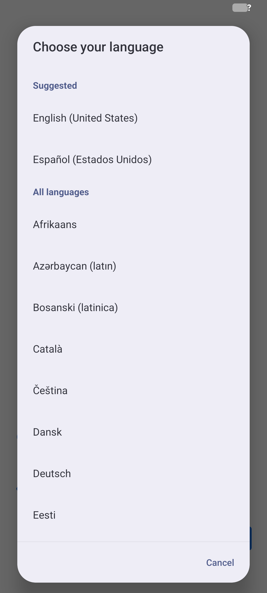

# M3 touch and physical keys

Current objective: let the operator use GT9886 touch, volume keys and the power
key to navigate the Android welcome screen and inspect Launcher. The accepted
trial-69 panel setup, trial-77 render permissions, GSI and existing 2 GiB/32 MiB
RAM test volumes remain the baseline. No repeated cold-start qualification.

## Evidence and implementation

F.20 read-only collection identifies touchpanel at I2C bus 8/address 0x5d,
hardware SE13 0xa94000, ten slots and absolute ranges 0..1079 / 0..2399.
Official board 20607 source maps I2C to TLMM36/37, reset to TLMM38, falling-edge
IRQ to TLMM39, AVDD to PM8150 L13 at 3.008 V and VDDIO to shared L14 at 1.8 V.
Its volume keys use PM8150 GPIO6/7; power uses the PON interrupt.

Trial 77 already registered pm8941_pwrkey. Its gpio-keys probe repeatedly returned
-517, and the inherited PMIC provider still used qcom,spmi-gpio, which does not
match the pinned native driver. The source DTBO now uses qcom,pm8150-gpio and its
IRQ domain, reserving every GPIO except the two measured volume-key pads. The
complete board key pin groups and upstream PON binding are retained.

The pinned 6.18 artifact contains no GT9886 driver. Port the GPL community
[GTX8 v2 submission](https://lkml.iu.edu/hypermail/linux/kernel/2602.3/08482.html)
with its attribution and source hashes in
[input/provenance.json](../device/realme/bladerunner_48m/input/provenance.json).
This is a submitted driver port, not a claim that GTX8 is merged into ACK.
Register and event layouts were compared to the official GT9886 implementation
at the project's pinned realme Android Q revision. The port uses the controller's
pre-flashed firmware; firmware/config flashing, gestures and fingerprint are
outside this candidate. That peripheral firmware remains a dependency.

The native GENI wrapper uses the measured SID 0x43, SE13 clocks/IRQ and upstream
interconnect paths. It is populated with the existing gated display fabric.
Only TLMM36..39 are added to the existing TE66/reset75 GPIO allowance. The
legacy overlapping I2C/wrapper compatibles are parked. The candidate uses the
native FIFO/SE-DMA path; GPI-only operation is not assumed supported.

Android receives a source IDC marking the controller as an internal,
orientation-aware touchscreen. Existing Generic.kl mappings cover Linux power
and volume keycodes. Input events must still be verified on the target.

## Power-key and debugging prerequisites

Trial 76 measured a system_server SwiftShader JIT failure during ColorFade after
an execmem denial. A source static vendor RRO sets only
config_displayColorFadeDisabled=true, using the exact signed GSI framework
resources and a local engineering APK certificate. No platform/factory signing
key is used and no SELinux neverallow is weakened. The APK is compiled and
signature-verified locally; runtime activation and screen off/on remain untested.
See [AOSP RRO configuration](https://source.android.com/docs/core/runtime/rros).

The RAM-data engineering boot now sets persist.sys.usb.config=adb as well as
sys.usb.config. The pinned AdbService initializes ADB_ENABLED from the persistent
property at systemReady, whereas trial 77 only set the transient property.
This makes the requested boot configuration consistent; it does not establish
the cause of trial 77's USB loss. Existing ADB authentication stays enabled.
Do not repeat the unobserved multi-write provisioning command from that trial.

## Checks and acceptance

Local input/display/M1 resource checks pass on the effective source tree after
the complete board DTBO. The compiled RRO contains exactly one bool, true, and
passes APK signature verification. Composed CIL is byte-identical to the strict
trial-76 policy proof. Compared with trial 77, vendor changes only USB init and
file labels, adding the RRO and touch IDC; HAL/runtime libraries are identical.

Kernel build 45166498874 succeeds; selected kernel members and source digests
are verified. All 27 candidate comparisons pass, including unchanged existing
kernel source manifests and only CONFIG_TOUCHSCREEN_GOODIX_GTX8 added. The
complete candidate is packaged; handset input checks remain pending. F.20 remains
running until the trial begins. Acceptance requires real getevent down/up
and touch coordinates, Android InputReader recognition, a physical tap changing
the welcome UI, volume-key response, and power-key off/on without losing the
framework or authenticated ADB. A kernel input node alone is not acceptance.

## Trial 78 early probe

After complete candidate readback, boot 8097409b-0bce-4f88-b7f4-63b941dd4119
registers gpio-keys successfully. Native SE13 cannot register: the kernel reports
`cannot create duplicate filename /bus/platform/devices/a94000.i2c`. The final
OEM overlay enabled the parked legacy node, which still creates a platform
device even without a matching driver. No touch transaction has run yet.

The next DTBO disables the legacy SE13 and wrapper in the final board overlay;
the resource checker now requires that disabled state. The kernel and vendor
remain the same. Physical key, touch and Launcher acceptance are still pending.

Trial 78 later reaches boot completion under enforcing, with authenticated ADB
retained. InputReader recognizes both physical key devices and Generic.kl. Real
volume-up/down press and release events are recorded; the operator confirms both
volume-up and volume-down UI responses. The static ColorFade overlay is enabled and its resource
resolves true. Power off/on and touch remain untested.

The attempted persist.sys.usb.config write from vendor_init is denied by the
platform system_prop label. Persistence is **not** achieved; the current gadget
remains adb and framework ADB_ENABLED becomes 1. Keep this failure explicit; do
not loosen property ownership or claim it fixes the prior USB loss.

Trial 79 keeps exactly the trial-78 kernel, vendor, GSI, container and test seeds.
Only the two legacy DT node status values change to disabled. All 27 input
candidate comparisons pass; the corrected checker rejects the trial-78 tree.

## Trial 79 native I2C and firmware identity

The name collision is resolved. Native a94000.i2c registers and the first
controller transaction returns firmware product ID 9885. The generic community
GT9886 match then rejects that ID with -22 before input registration. F.20 uses
the GT9886-family driver; that driver name was not proof of a 9886 firmware PID
or a physical silicon marking.

The official board driver reads 72 bytes at 0x452c, validates the byte-sum
checksum and sensor byte, and takes PID at offset 9. Its event layout matches
the Normandy path. Add a board-specific realme,rmx2072-goodix-normandy match
requiring exactly firmware PID 9885 and the complete version checksum. Generic
GT9886/GT9896 checks stay unchanged; arbitrary IDs are still rejected. No touch
firmware or config is written. The next kernel and real events remain pending.

### Power button and USB after screen off/on

Trial 79 reaches boot completion and retained enforcing GSI ADB. The operator
pressed power before the planned event capture: the screen went off and came
back on. PowerManager records power_button sleep and WAKE_REASON_POWER_BUTTON
wake. Boot ID, system_server PID 2399 and SurfaceFlinger PID 2131 survive. The
ColorFade resource resolves true and this operation does not reproduce the
previous system_server crash. Raw power-key getevent was not captured.

USB disappears during this operation and requires one cable replug to restore
authenticated ADB in the same boot. This is a failed USB-continuity result, not
a passed suspend/resume qualification. Shell cannot read the kernel log or UDC
registers, so the exact controller fault is not yet known. The current driver
programs qcom,select-utmi-as-pipe-clk only at probe. The upstream
[QSCRATCH UTMI resume patch](https://lkml.iu.edu/hypermail/linux/kernel/2610.3/04952.html)
is a relevant hypothesis, not handset root-cause proof. The optional PDC wake
IRQs are enabled only in host mode by this driver, so adding them alone would
not address this peripheral-mode path. No speculative IRQ change was applied.

Touch build 45176831092 uses e697e06 and remains isolated from USB driver changes.
The handset stays in GSI after the successful cable-replug recovery.

## Trial 80 physical touch acceptance

Kernel build 45176831092 succeeds from e697e06. All 27 candidate checks pass.
Relative to trial 79, the complete container, vendor, test seeds and DTBO are
identical. The effective base DT changes only the touch compatible to the
board-specific Normandy variant. Boot write/readback and the existing container
verification pass; the original recovery set is reused without fresh stock reads.

Boot 0ba56e5b-d33c-4509-9b5a-fb09ac76f047 validates the complete version checksum
and registers firmware PID 9885, version 5.3.0.4, as input event2. Android recognizes
an internal DIRECT touchscreen with coordinates 0..1079 and 0..2399. A physical
tap at (345, 1767) produces down, coordinates and release and opens the language
list. The operator confirms that scrolling follows the finger without obvious
offset or jumps. The 300-second input capture has 24 down/up pairs and 94 matching
boot/system_server/ADB samples. No touch was injected. Enforcing and boot completion
remain active, and the phone is retained in GSI.

The project IDC file is **not loaded**: InputReader is denied read access to its
incorrect vendor_file label. Default input inference supplies the observed correct
mapping. The source fix labels the IDC directory and file vendor_idc_file, matching
the pinned GSI platform contexts. Payload comparison changes only vendor file
contexts and leaves policy bytes unchanged. This fix is prepared, not installed
on the running trial-80 phone.

## Next blocker: real battery telemetry

The operator can navigate setup but it refuses continuation for low battery.
Live BatteryService reports present=false, level=0 and voltage=0; the Health HAL
is registered and /sys/class/power_supply has no nodes. These are missing values,
not a measured empty pack. No battery-state override was used.

The OEM board 20607 source has an external gauge at SE16 I2C 0x55 with the
qcom,batt_bq28z610 flag and qcom,external_gauge in its charger configuration.
The generic PM8150B fuel-gauge node is not sufficient to identify the active
board telemetry path. Next: verify the external gauge transport and read-only
measurements, expose them through power_supply to the existing Health HAL, then
resume setup and Launcher acceptance. USB resume continuity remains unresolved.

[Trial 80 evidence](../build/device/m3-input80-result-2026-11-23.json) ·
[Prepared IDC label fix](../build/device/m3-input-idc-label-fix-2026-11-23.json)
