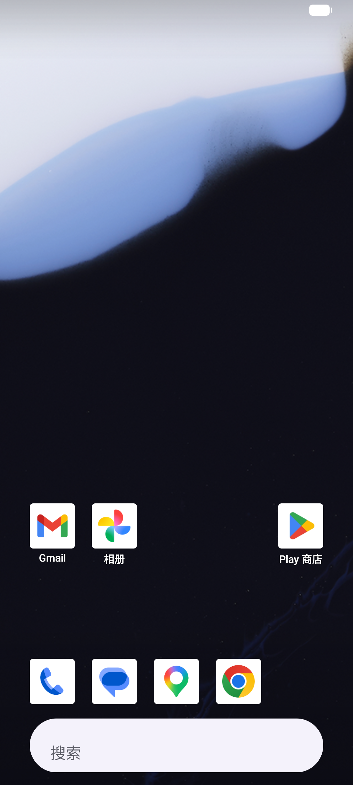

# M3: offline setup and Launcher

The current goal is a desktop the operator can inspect by physical touch on
ACK 6.18 and the unchanged Android 17 GSI. Trial 80 passes touch; trial 81
provides real battery telemetry. Trial 82 resolves the network-page black screen.

## Trial 82: network page passes

The previous vendor omitted android.hardware.wifi. The GSI SystemServer did
not start WifiService, and SetupWizard NetworkActivity repeatedly dereferenced
a null WifiManager. One permissions XML starts wifi and wifiscanner without
changing the kernel, device trees, policy, GSI or writable test seeds.

On boot 09d2dd9a-bf2a-438f-bc6e-03e3f5665843, the operator selects a language,
sees the WLAN page and selects offline setup. Date/time and protection pages
render normally. The log records NetworkActivity displayed and the same
system_server 2415 and SurfaceFlinger 2141 remain running under enforcing.
The 196.25-second ADB check passes. This is framework/UI acceptance; the
Wi-Fi radio driver, transport and HAL are still unported.

## GSI protection-page skip regression

Selecting Later, then Skip anyway, returns to date/time. The wrapper logs
subactivity request 10002 returning result 0 (RESULT_CANCELED), twice in the
saved trace. There is no SetupWizard or Settings crash at that transition.

Read-only inspection of this GSI's Settings APK identifies the positive callback:
SetupChooseLockGenericFragment$1 calls uploadMetrics(11, true) and then finishes
the activity. Its uploadMetrics path does not set the Activity result; the
onboarding helper also ignores the result-code argument. The default cancel
result therefore survives. By contrast, the android-17.0.0_r1 AOSP
SetupSkipDialog sets RESULT_SKIP directly; that source is not identical to the
prebuilt GSI implementation and cannot be used as proof of the installed code.

Settings APK SHA-256: 4c184e7abd0f4f38b09f2d2434eec778003f970bca35d2a17bba673fa7015b37.
The APK was not modified. Both device_provisioned and user_setup_complete remain
0. No artificial provisioning-complete or credential result was injected.

## Launcher prerequisite

A separate explicit Launcher3 start returns from ActivityManager but crashes
while reading AppWidgetManager.getInstalledProvidersForProfile. The appwidget
service and android.software.app_widgets feature are absent. Chrome also logs
a null AppWidgetManager in its widget receiver; Calendar has a widget crash.
The failed Launcher process is stopped and the date/time page remains usable.

Trial 83 adds only android.software.app_widgets.xml. Pinned SystemServer starts
AppWidgetService when this software feature is declared. Existing vendor files
and policy remain byte-identical. Next acceptance is service registration and
an independently rendered Launcher with physical app-open evidence. This does
not silently mark Google's setup completed or resolve its separate skip bug.

[Trial 82 evidence](../build/device/m3-setup82-result-2026-11-23.json) ·
[Trial 83 source scope](../build/device/m3-setup83-scope-2026-11-23.json) ·
[Battery result](M3_BATTERY_2026-11-23.md)

## Trial 83: Launcher renders; operator pauses

All 34 preflight checks pass, followed by candidate boot and complete container
readback. Boot 5b10cfc2-a792-47f1-ad7b-a5d1c875288e reaches enforcing/API 37 and
boot completion. AppWidgetService registers. An explicit start of the unchanged
GSI QuickstepLauncher succeeds; it remains top-resumed and renders wallpaper,
application icons and its search bar. The crash buffer after launch is empty.
BatteryService continues to read the real gauge (100%, pack voltage 8.650 V).

The operator was asked to confirm the physical screen and open the app drawer,
then requested a pause until tomorrow. Before the pause, the collector records
touch events and ADB observes the Dialer in the foreground. These are partial
input/UI observations; operator confirmation of the complete desktop test is
still pending. Both provisioning flags remain 0. The separate GSI skip-result
bug remains unresolved.

At uptime 391.603/391.784 s, getevent records a short physical power-key press.
USB then disappears. The input capture ends early (exit 255) after 20 same-boot
connection samples, with its last good sample at 60.62 s. The runner's final
temporary-file cleanup fails over ADB; its retention suite is **not passed**.
This correlates with the prior screen-sleep USB loss, but the exact driver fault
is not yet established. The last verified guardian mode is retained.

The runner attempts rollback after the disconnection, without confirmation.
No restoration write starts. On the user's pause request, its waiting process
and USB watcher are stopped. The last verified OS is GSI trial 83; F.20 has not
been restored and the current screen state is unconfirmed. Original recovery
files and the sole current candidate are preserved.

Resume with USB/ADB recovery and same-boot identity checks before any restart.
Then confirm physical desktop/app interaction, resolve the GSI skip callback,
and address screen-sleep USB continuity. No further cold-start repeats are planned.

[Trial 83 result](../build/device/m3-setup83-result-2026-11-23.json) ·
[GSI skip-code inspection](../build/device/m3-setup82-skip-code-2026-11-23.json)
